 

## Sobre mí

  

## Stack

| | |
|:--:|:--:|
| **Lenguajes** |  |
| **Frontend** |  |
| **Backend y datos** |  |
| **Herramientas** |  |

## Proyectos destacados

  
  
  
  

## Actividad

<picture>
  <source media="(prefers-color-scheme: dark)" srcset="https://raw.githubusercontent.com/KevinDC65/KevinDC65/output/snake-dark.svg"/>
  <source media="(prefers-color-scheme: light)" srcset="https://raw.githubusercontent.com/KevinDC65/KevinDC65/output/snake-light.svg"/>
  
</picture>

## Conectemos

&nbsp;

